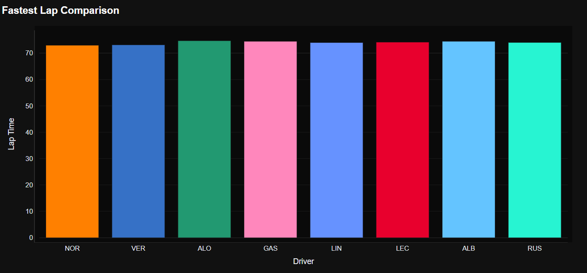
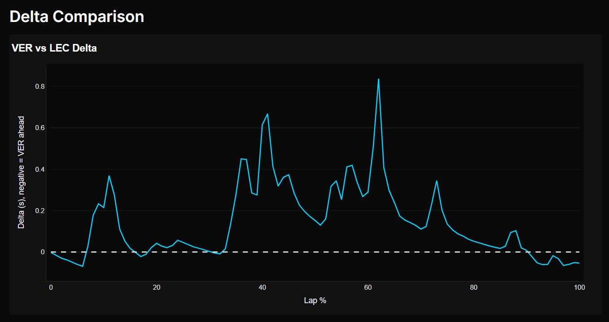
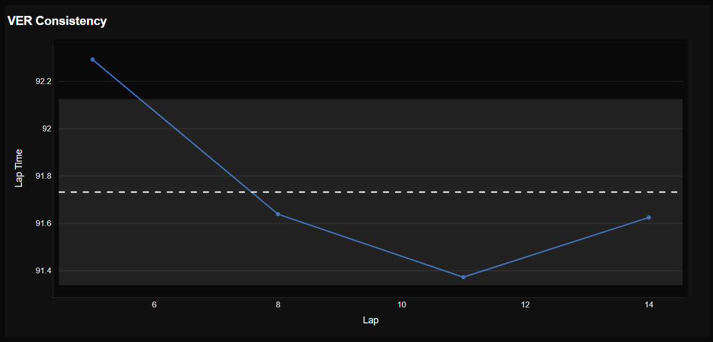

# Slipstream

Slipstream is Formula 1 data analysis dashboard on Streamlit, it uses FastF1 to pull all the data for each session and each race, processes it with Pandas and visualises with Plotly. My goal was to build something I can use myself and find entartaining as a Formula 1 fan that is also interesed in working with data but also hopefully fun for other F1 fans, but also visualise the data which makes it much easier to understand the decisions that lead to the outcomes in the sport. 



## How This Project Was Made
I built this project using:
* **Python**
* **Streamlit**
* **FastF1/tif1**
* **Pandas**
* **Plotly**
* **Hack Club Nest**

## Issues Throughout the Project
Considering that this is definetly my longest project but also my second time shipping, there were many issues as i was working on this project, first working on the functions that work with the data well, formula 1 data on its own is sometimes painful to work with especially with what to filter and how much and that shows up alot while working on the backend, i struggled with Streamlit syntax as well as i hadn't worked in it before and my main struggle was deployment as i also hadn't deployed through nest before

## How to Run Locally
1. Clone the repo:
```sh
git clone https://github.com/ivadebandit/Slipstream.git
cd Slipstream
```
2. Create and activate a virtual environment
```sh
python -m venv venv
source venv/bin/activate  
```
or on Windows use: `venv\Scripts\activate`

3. install the dependencies
```sh
pip install -r requirements.txt
```

4. Run the Streamlit app
```sh
streamlit run app.py 
```


## Features
* **Pace and Tires:** Visualises average stint pace, tire degradation, fuel effect and compound usage using default tire colors
* **Strategy:** Includes pit stop durations, lap 1 position changes and track position progress as well as undercuts and overcuts
* **Session Data:** Shows the theoretical perfect lap compared to the actual fastest lap, track evolution throughout the session and driver consistency
* **Qualifying and Telemetry:** Compares Q1/Q2/Q3 progress and visualises DRS zones 

*(note: The standings, cmparisons, and historical pages are disabled on the live server due to FastF1 API rate limits, but they do work locally)*





## Live Demo
https://iva33.hackclub.app

## AI Disclosure
I used ai for syntax (fastf1 and streamlit) and some debugging here and there and also for deployment in terminal